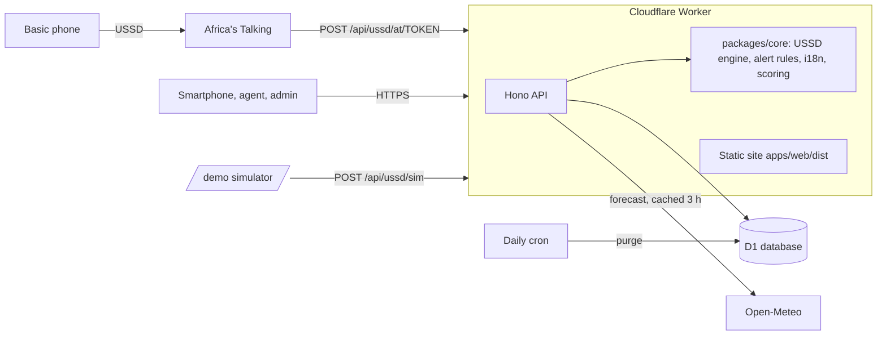
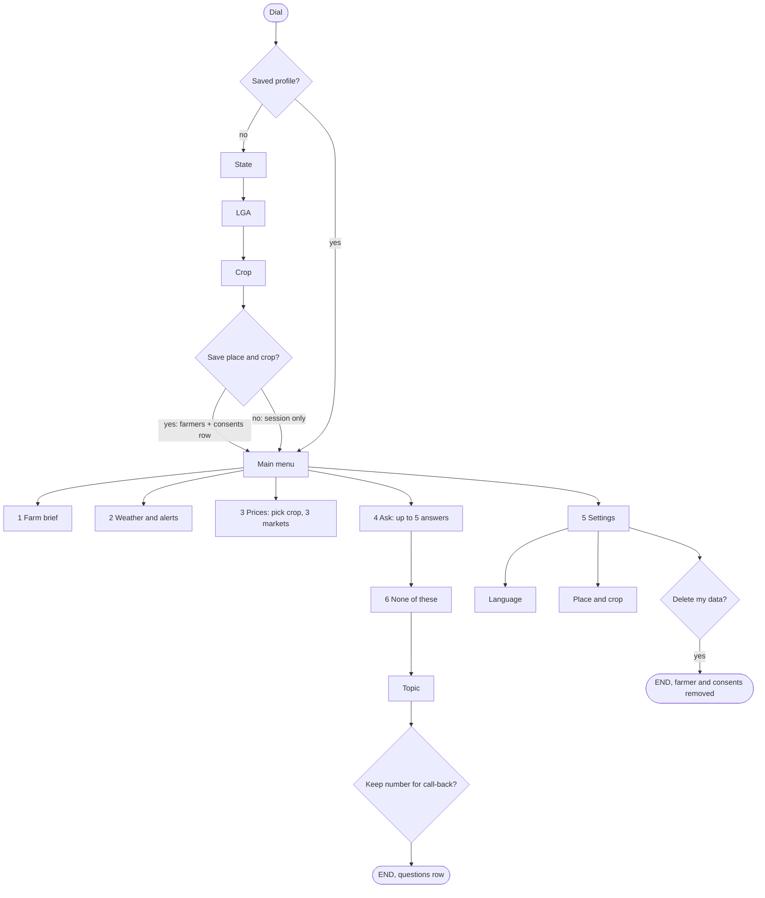
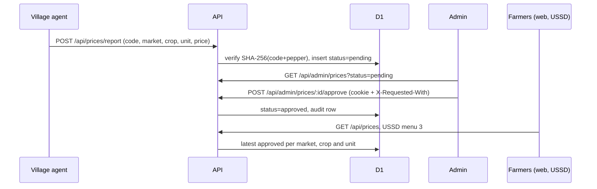
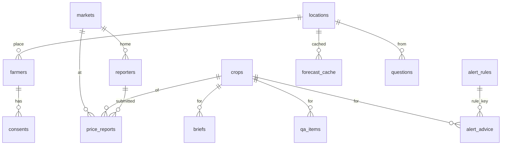

# Architecture

One repository, one Cloudflare Worker serving the API (`/api/*`, Hono) and the static Astro site (Workers static assets). Data in D1 (SQLite). Locally the same Hono app runs on Node with a SQLite file behind a D1-compatible shim.

## System

## USSD flow

State machine: `packages/core/src/ussd.ts`, `step(state, input, ctx)`. The API loads session state from `ussd_sessions`, passes the last `*`-segment as input, and supplies data through a `UssdCtx` (`lib/ussd-ctx.ts`). Every screen is passed through a GSM 7-bit sanitiser and clamped to 182 characters.

## Price approval flow

## Data model

Standalone tables: `ussd_sessions`, `events` (no personal data), `rate_limits`, `admin_audit`, `deletion_requests`.

## Key decisions

See `DECISIONS.md`. Highlights: content is shown only when `status = approved` and a reviewer and approval date exist; placeholders carry `is_placeholder` end to end; every outside service sits behind an adapter (`apps/api/src/adapters`); the web app has no framework runtime and no inline scripts.
